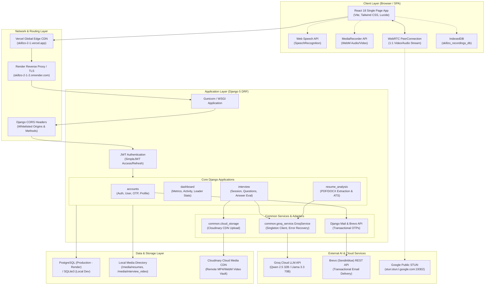
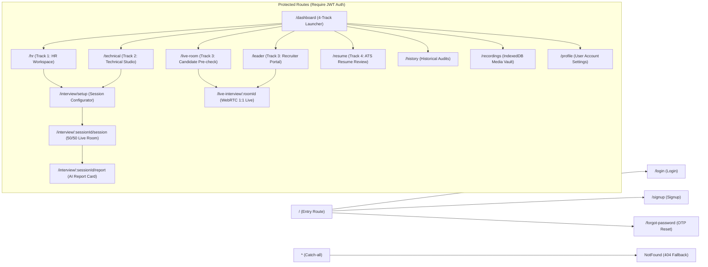
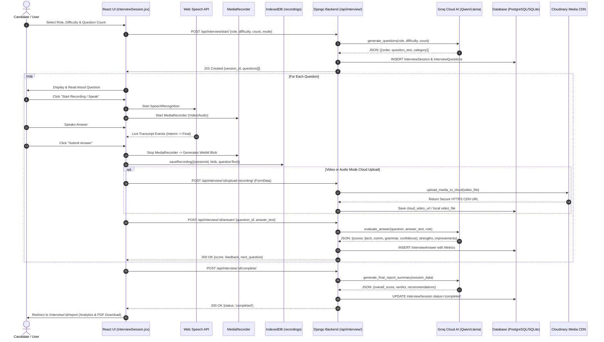
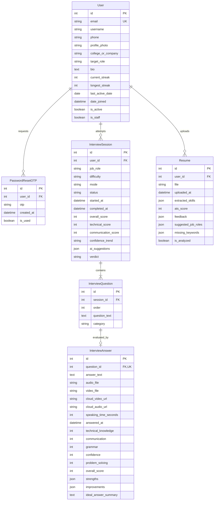

# Skillzo 2.1 - Editable Diagrams Source Repository

This directory contains the complete source code and structural specifications for all system diagrams in the Skillzo 2.1 AI Interview & Talent Intelligence Platform. All diagrams are authored in Mermaid standard syntax and can be rendered using Mermaid CLI, GitHub Markdown, or the Antigravity previewer.

---

## 1. System Architecture (`01_system_architecture.mmd`)

---

## 2. Frontend Routing Map (`02_frontend_routing.mmd`)

---

## 3. Interview Evaluation Sequence (`03_interview_evaluation_sequence.mmd`)

---

## 4. Database Entity-Relationship Diagram (`04_database_erd.mmd`)

